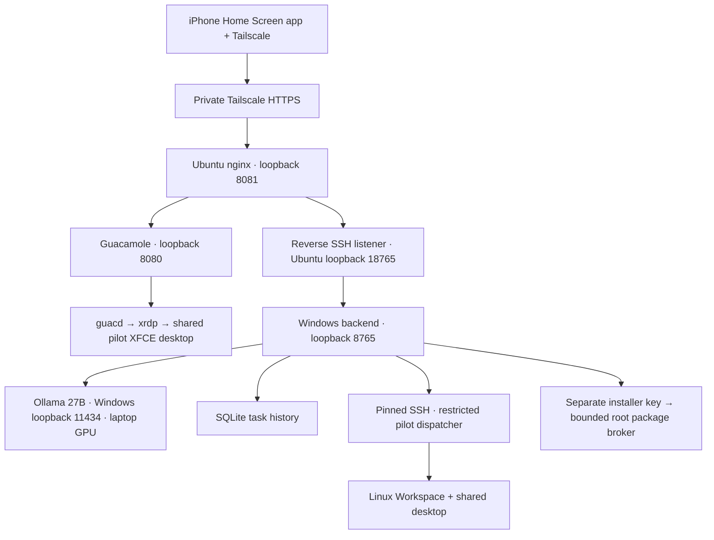

# How LocalPilot works

LocalPilot puts a real Linux computer and a local AI assistant behind a private iPhone web app. Windows supplies the GPU and runs the AI; Ubuntu supplies the desktop and execution account. Android, Strata, and switching models are outside current scope. The installed model tag is qwen3.8:latest, previously verified as the 27B Q4_K_M model; the runtime uses a 16,384-token context.

## What happens when you ask for a task

1. Your authenticated app sends the request to the Windows backend over the private route.
2. The backend asks the local model to choose a tool. The model receives task/observation data, not your operator token, SSH keys, or setup password.
3. File operations validate relative workspace paths. Proposed terminal commands, desktop input, and software installation pause for exact operator approval. Approval applies once to the frozen payload.
4. The restricted account performs the approved operation. The model sees its real output, checks the result, and continues within bounded turns. GUI input additionally requires a fresh screenshot/ownership revision.
5. Results and events are saved in SQLite and shown on your phone. Reloading the app does not replay commands. Interrupted tasks remain interrupted after backend restart.

## Accounts and trust

| Identity | Purpose | Boundary |
| --- | --- | --- |
| Windows signed-in user | Backend, inference, supervisor, private keys | Must be trusted; not a hardened sandbox against this user |
| Linux localpilot | Setup/maintenance administration | Setup key/password used only by operator provisioning/backup tools |
| Linux pilot | Workspace, execution, shared XFCE/Firefox | No sudo or Docker membership; approved code can access its own files/network |
| Linux lp-gateway | Fixed reverse SSH transport | No shell/PTY or arbitrary forwarding |
| Linux lp-installer | Fixed root broker invocation | Reviewed catalog plans only; no arbitrary sudo/repository editing |
| Protected Windows SYSTEM tasks | Start/address discovery for pinned VM | Do not run model/runtime code as administrator |

The runtime service has access to bounded installer credentials and is trusted as the approval authority. Browser approvals are not a separate cryptographic human attestation. Desktop ownership coordinates LocalPilot actions; independently running Linux programs or a direct Guacamole session are outside that UI gate. Use Take control before manual work. Root-owned dispatchers and policies keep pilot from changing the tool boundary, but approved shell code is not isolated in a separate per-command container.

## Availability and privacy

Linux ready checks actual SSH, writable workspace, and the shared desktop. It does not guarantee the model is loaded, a website is available, or the laptop will stay awake. A supervisor starts ordinary-user services after Windows sign-in and reconnects the private transport. A protected publisher tracks the pinned VM address; a guest timer refreshes the host-gateway SSH firewall rule.

Browser cookies are Secure/HttpOnly/SameSite=Strict, writes check Origin, and sign-out/restart revoke sessions. Offline web-app caching covers public reconnect assets only, never private API/task/desktop contents. Task data and screenshots are sent to the local model; the model does not use a paid cloud AI API. Tailscale provides the private transport, and ordinary browser visits/repository downloads still contact their respective internet services.

Source ownership, task limits, private key hygiene, repository signing, and operator review are important boundaries. This is a functional private MVP, not a security-audited multi-user hosting service. See the focused recovery, browser, installation, PWA, and backup documents for their tested scope and remaining limitations.
